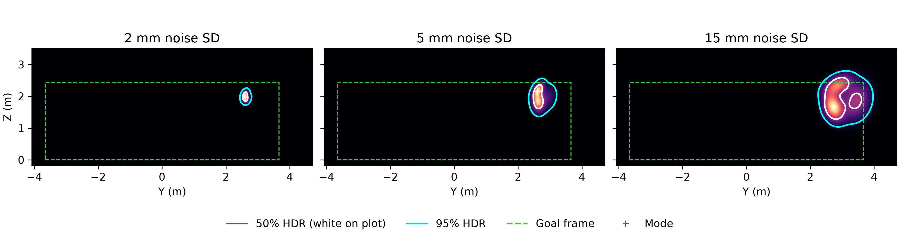

# UPC155 · Predicting a penalty kick from two observations

The model uses ball-centre positions at 50 and 100 ms to predict where the ball crosses the 11 m goal plane. The figure below shows the reference P1 forecast, conditional on crossing before ground contact. Contours mark the 50% and 95% joint prediction regions.



At a position noise standard deviation of 5 mm, the P1 case forecast has a mode near `(2.62, 2.15) m` and an estimated **97.3%** probability that the ball centre lies inside the specified rectangle, conditional on airborne crossing. [Case output](results/p1/case.json) · [Calibration figure](figures/coverage_fresh.png)

| Evidence | Result | Evaluation scope |
|---|---|---|
| Frozen P1 vs v1 fresh | Median error at 5 mm: **29.71 vs 28.18 cm** | Same 4,234 airborne simulated test trajectories. [Full scores](results/v1_fresh/test_scores.csv) |
| v3 ground-contact simulation | **88,999** direct crossings and **11,001** crossings after contact | Same 100,000 launch states. Of the latter, 6,636 cross while bouncing and 4,365 while rolling. [Sensitivity report](results/ground_contact/bounce_sensitivity.json) |
| Ground contact for the specified kick | The estimated ground-first mass was negligible in the sampled scenarios | Adaptive importance sampling under the canonical uniform prior, two seeds per noise setting. [Case audit](results/ground_contact/case_bounce_audit.json) |

The v3 ground-contact package contains the generated paired datasets and the full generation and training code; no v3 model checkpoint is stored here. The two stored checkpoints correspond to the frozen P1 network and the earlier v1 fresh network. The source-held-out audit under `results/source_holdout` documents a separate earlier protocol for an anchored-prior model: its real-trial replay is retrospective for every model whose fitted prior contains those trials, and held-out only for the `no Asai` model. [Source-held-out audit](results/source_holdout/README.md)

| Directory | Contents |
|---|---|
| [data/v3](data/v3/) | Paired airborne and ground-contact datasets, split indices and SHA-256 manifests |
| [simulation](simulation/) | RK4 flight, frozen sampling, ground contact, rolling, and the case audit |
| [models](models/) | Wiener-ResMDN comparison trainer, formally evaluated checkpoints, and P1 heatmap code |
| [figures](figures/) | Reference P1 heatmap and calibration figure |
| [results](results/) | Reference P1 scores, v1 paired scores, source-held-out audit, and v3 physics comparisons |

Install the dependencies in Python 3.10 or later. From the repository root, these commands regenerate the published heatmap, train the two arms, or expand the paired data:

```text
python -m pip install -r requirements.txt
python models/p1/plot_case.py outputs/p1_case

python models/train_bounce_control_mdn.py data/v3 outputs/airborne --arm airborne --epochs 100
python models/train_bounce_control_mdn.py data/v3 outputs/bounce --arm bounce --epochs 100

python simulation/generate.py outputs/expanded_200k --n 200000 --arm v3_all
python simulation/generate_bounce_dataset.py outputs/expanded_200k/v3_all outputs/expanded_200k/v3_all/bounce
```

See [dataset definitions and provenance](DATA_SOURCES.md) and [package checksums](SHA256SUMS).
